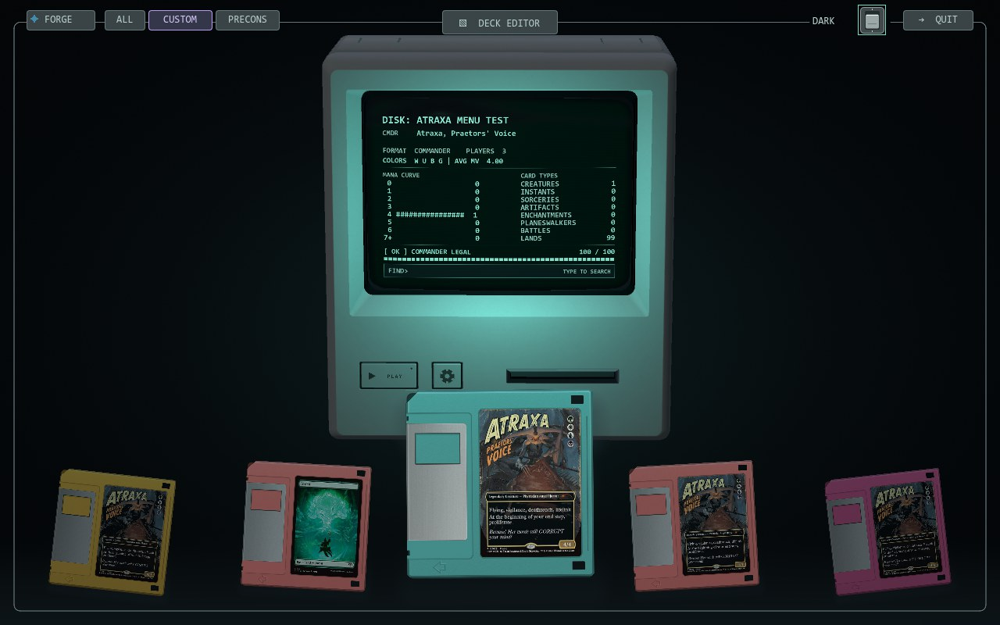
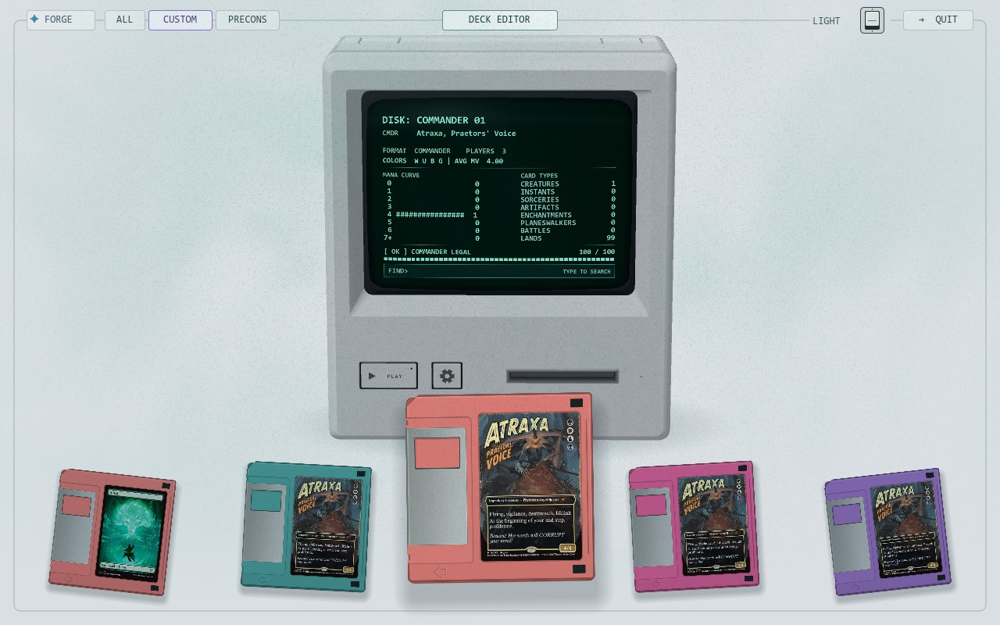
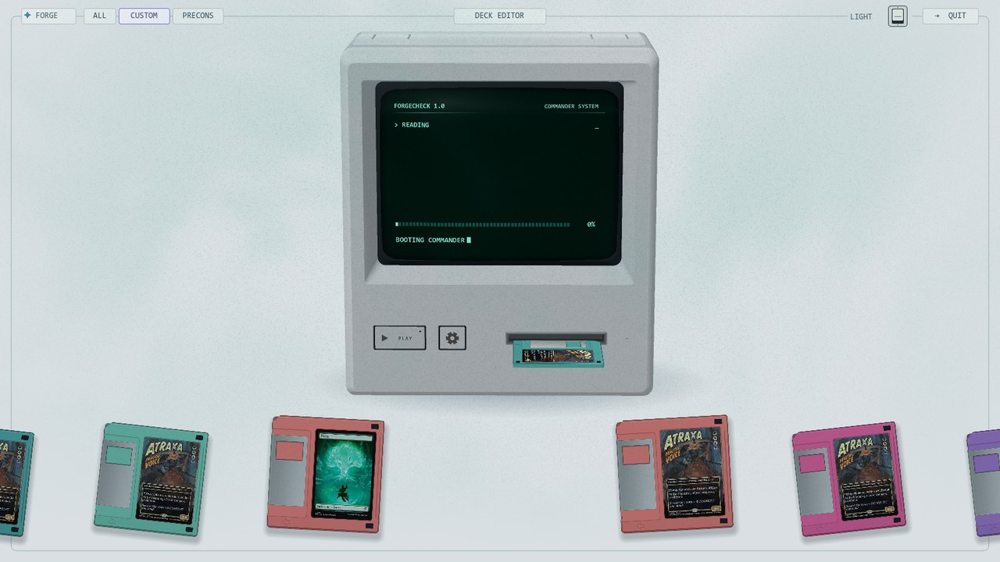
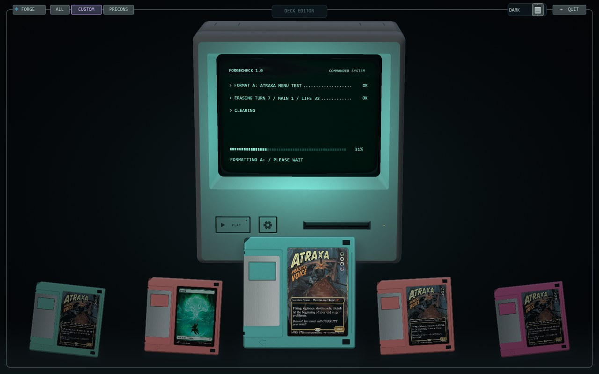
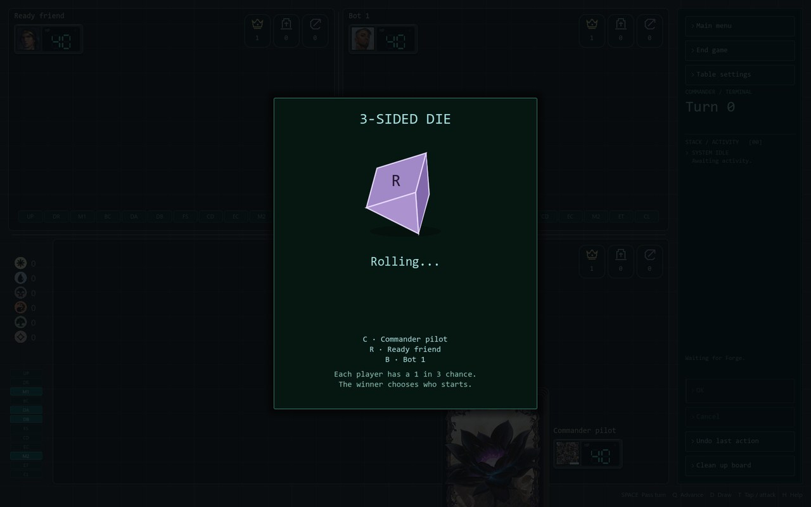
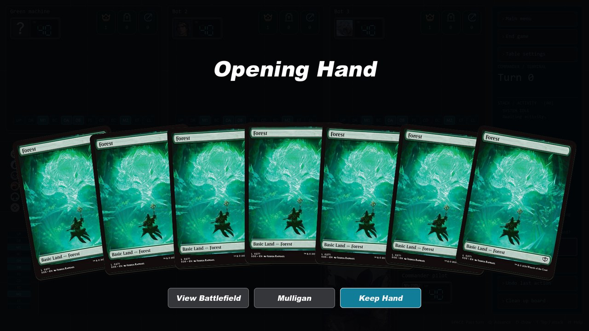
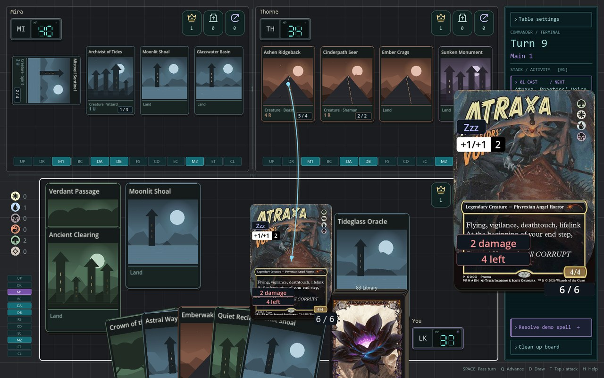
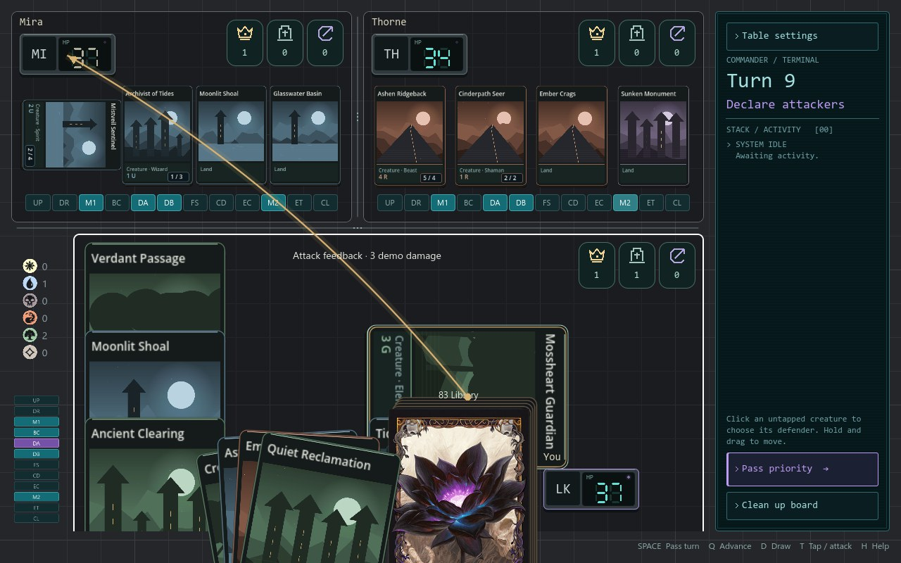
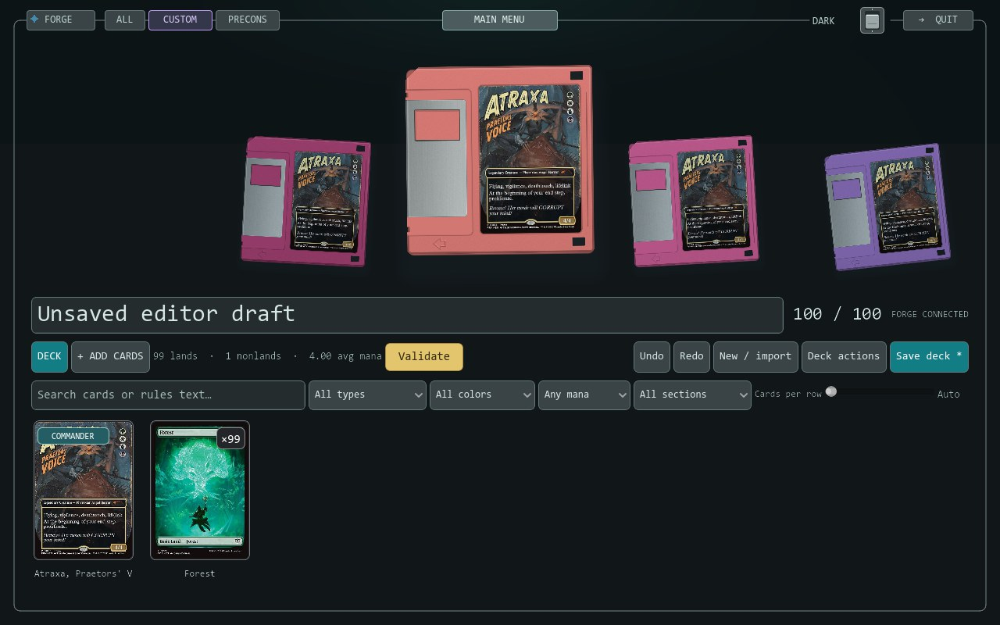

<div align="center">

```text
  ╔════════════════════════════════════════════════════════════════════════════╗
  ║ ┌────────────────────────────────────────────────────────────────────────┐ ║
  ║ │ FORGECHECK 1.0                                        COMMANDER SYSTEM │ ║
  ║ │ ────────────────────────────────────────────────────────────────────── │ ║
  ║ │                                                                        │ ║
  ║ │    ███████╗  ██████╗  ██████╗   ██████╗  ███████╗    ██╗   ██╗ ██╗     │ ║
  ║ │    ██╔════╝ ██╔═══██╗ ██╔══██╗ ██╔════╝  ██╔════╝    ██║   ██║ ██║     │ ║
  ║ │    █████╗   ██║   ██║ ██████╔╝ ██║  ███╗ █████╗      ██║   ██║ ██║     │ ║
  ║ │    ██╔══╝   ██║   ██║ ██╔══██╗ ██║   ██║ ██╔══╝      ██║   ██║ ██║     │ ║
  ║ │    ██║      ╚██████╔╝ ██║  ██║ ╚██████╔╝ ███████╗    ╚██████╔╝ ██║     │ ║
  ║ │    ╚═╝       ╚═════╝  ╚═╝  ╚═╝  ╚═════╝  ╚══════╝     ╚═════╝  ╚═╝     │ ║
  ║ │                                                                        │ ║
  ║ │ > READING DISK A: ................................................. OK │ ║
  ║ │ > LOADING FORGE RULES ENGINE ...................................... OK │ ║
  ║ │ > SEATING 4 PLAYERS ............................................... OK │ ║
  ║ │                                                                        │ ║
  ║ │ ██████████████████████████████████░░░░░░░░░░░░░░░░░░░░░░░░░░       57% │ ║
  ║ │ BOOTING COMMANDER █                                                    │ ║
  ║ └────────────────────────────────────────────────────────────────────────┘ ║
  ║                                                                            ║
  ║   [ > PLAY ]  [ * ]                    [==========================]  ·     ║
  ║                                                                            ║
  ╚════════════════════════════════════════════════════════════════════════════╝
                                                 ┌──┬────────┬──┐
                                                 │  │ ▄▄▄▄▄▄ │  │
                                                 │  └────────┘  │
                                                 │  ┌────────┐  │
                                                 │  │ ATRAXA │  │
                                                 └──┴────────┴──┘
```

**A retro-computer Commander table, powered by the real Forge rules engine.**
<br>
Your decks are floppy disks. Insert one, boot the match, play against bots or friends.




</div>

---

## `01` &nbsp;INSERT DISK

ForgeUI is a native [Godot](https://godotengine.org/) frontend for Magic: The Gathering Commander. Every rule, cost, target, combat step and decision comes from the real [Forge](https://github.com/Card-Forge/forge) engine running alongside it; ForgeUI is the table you play on.

```text
 ┌─[ SYSTEM FEATURES ]──────────────────────────────────────────────────┐
 │                                                                      │
 │  [■] A procedural retro computer as your home screen, with a live    │
 │      CRT, a floppy-disk deck carousel and a day/night light switch   │
 │  [■] Each deck is a floppy wearing its commander's artwork           │
 │  [■] The CRT shows mana curve, card types, legality and FIND> search │
 │  [■] Insert a disk to boot a real match, with a real boot log        │
 │  [■] Commander for up to 4: you, Forge bots and online friends       │
 │  [■] Bots play your decks, Forge precons or generated decks          │
 │  [■] Forge-backed deck editor with search, printings and validation  │
 │  [■] Coin, 3-sided prism or 4-sided die decides who chooses first    │
 │  [■] Leave mid-game and a session disk keeps your match parked       │
 │  [■] When a game ends, the drive runs FORMAT A: on the session disk  │
 │                                                                      │
 └──────────────────────────────────────────────────────────────── OK ──┘
```

## `02` &nbsp;SCREEN CAPTURES

<table>
  <tr>
    <td width="50%"></td>
    <td width="50%"></td>
  </tr>
  <tr>
    <td align="center"><sub><code>HOME / DAY</code><br>Every deck is a floppy. The CRT reads the selected disk.</sub></td>
    <td align="center"><sub><code>HOME / NIGHT</code><br>Flip the light switch: same room, lit by the CRT.</sub></td>
  </tr>
  <tr>
    <td></td>
    <td></td>
  </tr>
  <tr>
    <td align="center"><sub><code>BOOT</code><br>Insert the disk. ForgeCheck boots the match.</sub></td>
    <td align="center"><sub><code>FORMAT A:</code><br>A finished match is erased from its session disk.</sub></td>
  </tr>
  <tr>
    <td></td>
    <td></td>
  </tr>
  <tr>
    <td align="center"><sub><code>WHO GOES FIRST</code><br>Forge's toss, as a coin or a die with one face per player.</sub></td>
    <td align="center"><sub><code>OPENING HAND</code><br>Engine-run mulligans: keep, mulligan or look at the table.</sub></td>
  </tr>
  <tr>
    <td></td>
    <td></td>
  </tr>
  <tr>
    <td align="center"><sub><code>THE TABLE</code><br>Stack, counters, damage readouts and digital HP.</sub></td>
    <td align="center"><sub><code>COMBAT</code><br>Arrows show attackers, blockers and targets.</sub></td>
  </tr>
  <tr>
    <td colspan="2"></td>
  </tr>
  <tr>
    <td colspan="2" align="center"><sub><code>DECK EDITOR</code><br>The carousel scrolls up and the deck's cards appear below, backed by Forge's card catalog.</sub></td>
  </tr>
</table>

<sub>The table and combat captures come from the built-in demo table, which uses placeholder art for non-commander cards.</sub>

## `03` &nbsp;BOOT SEQUENCE

```text
> .\client-godot\tools\run.ps1          home computer, decks and PLAY
> .\client-godot\tools\run.ps1 -Decks   straight into the deck editor
> .\client-godot\tools\run.ps1 -Live    a real match against two bots
> .\client-godot\tools\run.ps1 -Mock    the demo table, no engine needed
```

On Windows, run `.\client-godot\tools\run.ps1`; in Git Bash or on macOS, run `bash ./client-godot/tools/run.sh` with the same flags. See [Setup](#setup) first if this is a fresh clone.

1. **Pick a disk.** Scroll the carousel, or type on the home screen to filter decks with `FIND>`.
2. **Configure the table.** The gear key beside PLAY sets up one to three bots, their decks, names and Forge portraits. See [main menu and Commander startup](docs/main-menu.md).
3. **Press PLAY.** The disk feeds into the drive and the CRT boots the match.

### Online with friends

The host's ForgeUI runs the match and friends join with the same ForgeUI build. Everyone presses their own PLAY key to ready up. Joining players get a **Rejoin** disk if their app closes mid-game. Stock Forge clients cannot join a ForgeUI match. See [online play](docs/online-play.md).

## `04` &nbsp;KEYBOARD

```text
 ┌───────┐ ┌───┐ ┌───┐ ┌───┐ ┌───┐
 │ SPACE │ │ Q │ │ D │ │ T │ │ H │
 └───────┘ └───┘ └───┘ └───┘ └───┘
   pass     ok   draw  tap/  help
   turn               attack
```

| Input | Action |
|---|---|
| `Space` | Pass the turn. Stops if you're attacked, targeted or facing mass removal. |
| `Q` | Press the primary button (OK, Keep, Resolve…) |
| `D` | Take a pending draw |
| `T` | Tap / attack |
| `H` | Help |
| `Right-click` | Inspect a card or open its menu |
| `Right-drag` / `Shift`+drag | Move a whole pile of identical permanents |
| `Esc` | Return from "View battlefield" to the pending decision |

**Table settings** at the top of the right rail set the hand spread, library sleeve, pile spacing and an optional stack notification chime. You can drop your own MP3 onto the window to use as the chime.

UI size is per device: **Settings → UI SIZE → Save & Return**. Automatic uses 100% on Windows and 200% on Mac; either can choose 100–200%. See [display scaling](docs/display-scaling.md).

---

## `05` &nbsp;DEVELOPER MANUAL

```text
 ┌─────────────────────┐      WebSocket JSON      ┌─────────────────────┐
 │  client-godot/      │ ◄──────────────────────► │  bridge/  (Java 17) │
 │  Godot 4.7.2 table  │   library  :7778         │  Forge, headless    │
 │  CRT, disks, board  │   match    :dynamic      │  one JVM per match  │
 └─────────────────────┘                          └──────────┬──────────┘
                                                             │
                                                  ┌──────────▼──────────┐
                                                  │  forge/  (pinned)   │
                                                  │  rules, cards, AI   │
                                                  └─────────────────────┘
```

### Layout

- `forge/`: upstream Card-Forge/forge, checked out at `FORGE_COMMIT` (not tracked here), with tracked local patches described in [FORGE_PATCHES.md](FORGE_PATCHES.md).
- `bridge/`: Java module implementing `IGuiGame`. It runs Forge headless and serves game state and prompts as JSON over WebSocket, plus a bare test page.
- `client-godot/`: Godot 4.7.2 application and Commander table for up to four players, with mock and live Forge adapters.
- `docs/`: bridge audit, the current local JSON protocol contract and feature references.

### Shared Windows and Mac development

Source lives in [LandonPatam/ForgeRevamp](https://github.com/LandonPatam/ForgeRevamp). Both platforms share one main branch; features and platform fixes use short-lived branches. See [the development workflow](docs/development-workflow.md). Mac support is reconciled with the Windows source; the [Mac](docs/mac-reconciliation.md) and [Windows](docs/windows-reconciliation.md) acceptance records describe the checks and remaining live cross-platform verification.

### Setup

Install Git, JDK 17, Maven and Godot 4.7.2 (plus its export templates for packaging). Windows scripts default to portable tools under `.tools/`; use the script-specific environment overrides for tools installed elsewhere. On macOS, `bash client-godot/tools/run.sh` starts the app and its owned Java service; `-Decks`, `-Mock`, `-Live`, `-Connect`, `-Editor`, `-Check` and `-Capture` select the corresponding source workflows. See [macOS prerequisites and packaging](docs/macos-build.md).

After cloning this repository, fetch the pinned Forge source and apply its local patches:

```sh
git init forge && cd forge
git remote add origin https://github.com/Card-Forge/forge.git
git fetch --depth 1 origin $(cat ../FORGE_COMMIT) && git checkout FETCH_HEAD
git apply --check ../forge-patches/netplay-fixes.patch
git apply ../forge-patches/netplay-fixes.patch
../.tools/apache-maven-3.9.9/bin/mvn -DskipTests -pl forge-gui-desktop -am flatten:flatten install
```

The Maven path above is the Windows portable installation; substitute your Maven executable on Mac. Apply the patch once to a fresh pinned checkout. Preserve existing Forge edits when working in an established checkout; see [FORGE_PATCHES.md](FORGE_PATCHES.md).

`flatten:flatten` matters: without it the installed poms keep `${revision}` and `bridge/` can't resolve Forge.

### Running the app from source

Run `.\client-godot\tools\run.ps1` (Bash: `bash ./client-godot/tools/run.sh`) to open the shared main menu. Select a saved deck and use **Play** to start Commander, or open **Deck Editor**. The cog beside Play configures one to three bots, their saved decks, Forge Commander precons, decks generated around a selected commander, or fully random Forge-generated decks, and everyone's names and profile pictures. See [main menu and Commander startup](docs/main-menu.md).

Open the Forge-backed deck editor with `.\client-godot\tools\run.ps1 -Decks`, or `bash ./client-godot/tools/run.sh -Decks` in Bash. Deck Editor scrolls the home carousel to the top, with the selected deck's cards underneath. Right-click cards for copy, removal, artwork and section actions. New / import creates, duplicates and imports decks. See [deck collection](docs/deck-collection.md) for controls and tests.

Run `.\client-godot\tools\run.ps1 -Live` to start a real Commander match directly against two AIs, using your installed Commander decks. Add `-Deck "Sauron"` to select your deck. Closing the Godot window stops the engine started by this launcher. The bridge must be packaged first with `.\bridge\tools\test.ps1`. Use `-Mock` for the standalone mock table. See [client-godot/README.md](client-godot/README.md) for controls, setup, boundaries, and verification commands.

In Git Bash / Anaconda Bash, run `bash ./client-godot/tools/run.sh -Live` for a direct match. Omit `-Live` for the main menu, or use `-Mock` for the mock. To attach to an existing three-player bridge, use `-Connect` instead of `-Live`; `-Port` selects its port.

### Packaging

- **Windows:** `.\client-godot\tools\package.ps1` writes `dist/ForgeUI/` and `dist/ForgeUI-windows.zip` with a bundled Java runtime.
- **macOS:** `python3 client-godot/tools/package-macos.py` builds a universal app and DMG with separate Apple Silicon and Intel Java 17 runtimes. Drag ForgeUI.app to Applications. See [build setup and signing](docs/macos-build.md).

### Updating to a new Forge snapshot

Record the new upstream revision in `FORGE_COMMIT`, re-apply and verify the local patches as described in `FORGE_PATCHES.md`, then rebuild. Online friends should use builds from the same ForgeUI commit and Forge revision.

### Running the bridge directly

```sh
cd bridge
../.tools/apache-maven-3.9.9/bin/mvn -DskipTests package
sh run.sh --deck "Sauron" --opponents 3
```

Open http://127.0.0.1:7777/. Decks come from Forge's normal Commander deck folder (`%APPDATA%\Forge\decks\commander`); AI opponents use your other decks. `node tools/probe.mjs` prints a text summary of the live game (dev tool).

For a three-player match in PowerShell, after packaging:

```powershell
cd D:\ForgeUI\bridge
java -Xmx4g -cp "target/classes;target/lib/*" forgeui.bridge.BridgeMain --assets ../forge/forge-gui --opponents 2
```

The bridge requires protocol v2 metadata for actions/answers; the bundled browser page and probe are updated. See [docs/protocol.md](docs/protocol.md) for Godot integration, reconnect behavior, validation, and remaining gaps. Forge remains authoritative; local upstream patches are recorded separately in `FORGE_PATCHES.md`.

### Checks

Run from the repository root:

```powershell
.\bridge\tools\test.ps1
node bridge/tools/client-checks.mjs
node bridge/tools/smoke.mjs
```

`test.ps1` packages offline using the existing Maven cache, then explicitly runs the dependency-free Java regression harness (plain Maven test discovery does not run it). `client-checks.mjs` checks browser protocol/recovery logic without launching a browser. `smoke.mjs` starts its own JVM on an available local port, exercises a real three-player AI match's protocol, then stops that process. It requires the same Forge assets, installed dependencies, and Commander decks as normal startup. `FORGE_SMOKE_PORT` can select a specific port. Set `FORGE_SMOKE_SCREENSHOT` to an absolute PNG path to also capture the browser test page using headless Edge (`FORGE_EDGE_PATH` overrides the browser executable). These checks do not establish complete spellcasting or combat coverage.

UI and online checks: `node client-godot/tools/app-check.mjs --render`, `node client-godot/tools/library-check.mjs --render`, `node bridge/tools/online-check.mjs`, and the automated precon playtest `node bridge/tools/playtest.mjs` ([docs/playtest.md](docs/playtest.md)).

---

<div align="center">

```text
 > FORMAT A: ................................................ OK
 > INSERT NEXT DISK_
```

<sub>ForgeUI is an unofficial fan project and is not affiliated with or endorsed by Wizards of the Coast.<br>
Magic: The Gathering and card artwork are property of Wizards of the Coast and their artists. Rules engine by the <a href="https://github.com/Card-Forge/forge">Forge</a> project.</sub>

</div>
